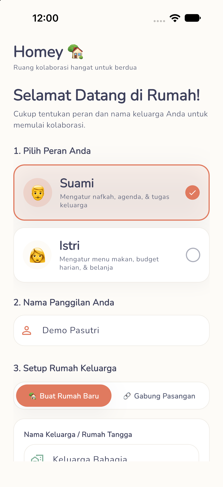
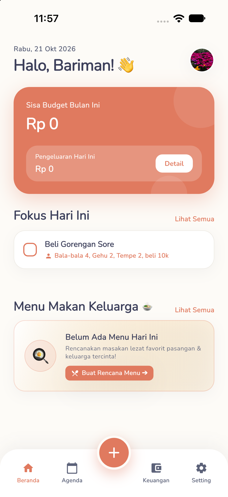
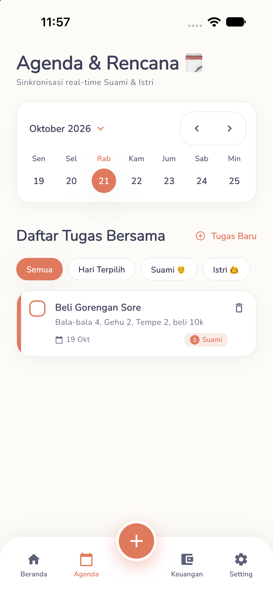
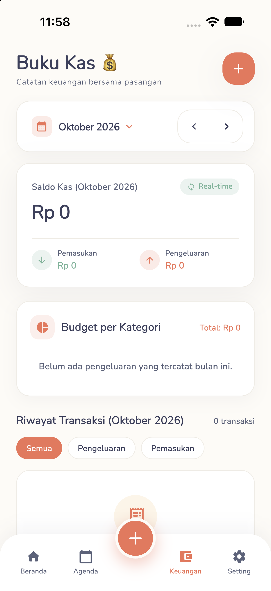
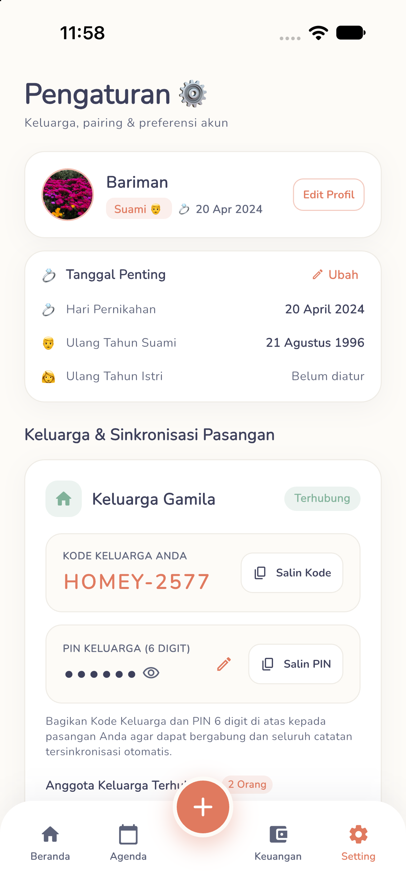

<div align="center">

  

  # Homey 🏡
  **Ruang Kolaborasi Hangat & Manajemen Rumah Tangga Real-Time untuk Pasangan**

  [](https://flutter.dev)
  [](https://dart.dev)
  [](https://supabase.com)
  [](https://bloclibrary.dev)
  [](#-dukungan-multi-platform--responsif)
  [](#-arsitektur--struktur-proyek)

  <p align="center">
    <i>"Satu aplikasi untuk menyelaraskan keuangan, agenda, dan menu harian suami & istri tanpa friksi."</i>
  </p>

</div>

---

## 📖 Tentang Homey

Mengelola rumah tangga memerlukan komunikasi yang transparan dan sinkronisasi harian yang konsisten. Sering kali catatan keuangan terpisah, tugas rumah tangga terlupakan, dan rencana menu makan harian membingungkan kedua belah pihak.

**Homey** hadir sebagai solusi all-in-one yang dirancang dengan pendekatan visual hangat (*cozy & warm family design*). Melalui integrasi **Supabase Realtime**, setiap perubahan catatan kas, tugas, maupun menu yang dilakukan oleh salah satu pasangan (Suami atau Istri) akan ter-update secara otomatis di perangkat pasangannya secara instan.

---

## 📸 Galeri Antarmuka (Screenshots)

Berikut adalah tampilan antarmuka aplikasi Homey yang diambil langsung dari perangkat:

| 1. Autentikasi & Pilih Peran | 2. Dashboard Pasutri | 3. Agenda & Rencana Bersama |
| :---: | :---: | :---: |
|  |  |  |
| *Login ramah keluarga & pemilihan peran personal (Suami 👨 / Istri 👩)* | *Sapaan personal, status pairing keluarga, saldo kas bulanan & highlight menu* | *Kalender mingguan interaktif, delegasi tugas (Suami/Istri/Bersama), & filter* |

| 4. Buku Kas Bersama | 5. Profil & Kode Keluarga |
| :---: | :---: |
|  |  |
| *Pencatatan kas real-time, filter bulan & tahun, dan progress limit budget* | *Kode unik keluarga (Family Pairing), info akun pasutri, & pengaturan* |

---

## ✨ Fitur-Fitur Utama

### 1. 🔗 Family Pairing System (Sinkronisasi Akun Keluarga)
- Hubungkan akun Suami dan Istri dengan mudah melalui **Kode Keluarga Unik**.
- Setelah terhubung, kedua akun berbagi satu data keluarga (*shared tenancy*), memastikan semua aktivitas tersinkronisasi dua arah.
- Profil pengguna dilengkapi foto profil, peran (Suami 👨 / Istri 👩), dan indikator status pasangan.

### 2. 💰 Buku Kas Pasutri (Joint Ledger)
- **Pencatatan Transparan:** Catat pemasukan dan pengeluaran secara cepat dan real-time.
- **Filter Periode Dinamis:** Navigasi mudah untuk meninjau riwayat transaksi per bulan dan tahun.
- **Tracking Budget Kategori:** Pantau persentase alokasi belanja rumah tangga (Kebutuhan Dapur, Tagihan Bulanan, Hiburan, dll) dengan bar indikator warna.
- **Filter Mutasi:** Tampilan transaksi yang bisa difilter instan (Semua, Pengeluaran, Pemasukan).

### 3. 🗓️ Shared Agenda & To-Do List
- **Delegasi Tugas:** Tugas dapat diberikan secara spesifik ke *Suami*, *Istri*, atau *Bersama*.
- **Kalender Mingguan:** Pantau jadwal padat secara ringkas dalam rentang 7 hari.
- **Filter Status Tugas:** Filter tugas berdasarkan *Semua*, *Hari Ini*, *Selesai*, atau *Belum*.
- **Checklist Interaktif:** Ketuk checklist untuk menyelesaikan tugas secara instan dengan umpan balik visual yang memuaskan.

### 4. 🍲 Perencana Menu Makan (Meal Planner)
- Perencanaan menu makanan keluarga untuk **Sarapan**, **Makan Siang**, dan **Makan Malam**.
- Menghilangkan pertanyaan harian *"Hari ini masak apa?"* dengan perencanaan bersama yang jelas.

### 5. 📱💻 Dukungan Multi-Platform & Responsif
- **Mobile (iOS & Android):** Navigasi bawah melayang (*floating bottom navigation*) dengan tombol aksi cepat (FAB) di tengah.
- **Web & Desktop:** Layout adaptif dengan Sidebar navigasi di sisi kiri dan tata letak multi-kolom yang nyaman di monitor layar lebar.

---

## 🎨 Filosofi Desain (Design System)

Homey mengusung estetika visual yang hangat dan menenangkan (*Cozy Family Theme*):
- **Palet Warna:**
  - `Terracotta (#E07A5F)`: Aksen utama yang hangat dan bersemangat.
  - `Sage Green (#81B29A)`: Representasi ketenangan, kesegaran, dan pemasukan keuangan.
  - `Warm Cream (#FDFBF7)` & `Warm Card (#FFFFFF)`: Latar belakang lembut yang nyaman di mata.
  - `Soft Yellow (#F2CC8F)`: Aksen pelengkap untuk highlight dan peringatan ramah.
- **Tipografi:** Google Fonts **Nunito** yang ramah, bulat, dan mudah dibaca.
- **Micro-Interactions:** Sudut membulat modern (`BorderRadius: 16-24px`), bayangan lembut (*soft ambient shadows*), dan transisi halus.

---

## 🏗️ Arsitektur & Struktur Proyek

Proyek ini dibangun menggunakan prinsip **Clean Architecture** dengan pendekatan **Feature-First**:

```text
homey/
├── assets/
│   ├── icons/               # Ikon aplikasi multi-platform (Android, iOS, Web)
│   ├── images/              # Ilustrasi & aset grafis
│   └── ss_page/             # Tangkapan layar antarmuka aplikasi
├── lib/
│   ├── core/                # Modul global yang digunakan lintas fitur
│   │   ├── constants/       # AppColors, AppRadii, AppShadows, SupabaseConstants
│   │   ├── database/        # Local SQLite database helper & caching
│   │   ├── di/              # Dependency Injection (GetIt)
│   │   ├── errors/          # Custom exceptions & failures
│   │   ├── presentation/    # Layout adaptif, widget kustom & responsive helper
│   │   ├── router/          # Rute aplikasi (GoRouter)
│   │   └── theme/           # AppTheme konfigurasi
│   ├── features/            # Fitur modular (Clean Architecture)
│   │   ├── auth/            # Autentikasi, Profil, dan Family Pairing
│   │   ├── dashboard/       # Halaman ringkasan utama pasutri
│   │   ├── finance/         # Buku Kas Pasutri (Cubit, Model, Repository, Pages)
│   │   ├── meal_planner/    # Perencana menu makan harian
│   │   ├── splash/          # Splash screen & pengecekan sesi login
│   │   └── todo/            # Agenda, kalender mingguan, & tugas pasutri
│   └── main.dart            # Entry point aplikasi
└── test/                    # Pengujian unit & widget (BlocTest & Mocktail)
```

---

## 🚀 Memulai (Getting Started)

### Prasyarat
1. Pasang [Flutter SDK](https://docs.flutter.dev/get-started/install) (disarankan menggunakan [FVM](https://fvm.app/) versi `3.35.7` ke atas).
2. Perangkat emulator Android / Simulator iOS atau browser Google Chrome untuk Web.

### Langkah Instalasi

1. **Clone repositori:**
   ```bash
   git clone https://github.com/your-username/homey.git
   cd homey
   ```

2. **Pasang dependensi:**
   ```bash
   fvm flutter pub get
   ```

3. **Konfigurasi Supabase (Opsional):**
   Aplikasi sudah dilengkapi dengan konfigurasi default untuk pengembangan. Jika ingin menghubungkan ke proyek Supabase milik Anda sendiri, jalankan dengan `--dart-define`:
   ```bash
   fvm flutter run \
     --dart-define=SUPABASE_URL=https://your-project.supabase.co \
     --dart-define=SUPABASE_ANON_KEY=your-anon-key
   ```

4. **Jalankan Aplikasi:**
   - **Mode Mobile (iOS / Android):**
     ```bash
     fvm flutter run
     ```
   - **Mode Web:**
     ```bash
     fvm flutter run -d chrome
     ```

---

## 🧪 Pengujian (Testing) & Analisis Kode

Pastikan kualitas kode tetap terjaga dengan menjalankan linter dan test suite:

- **Analisis Statis:**
  ```bash
  fvm flutter analyze
  ```
- **Menjalankan Unit & Cubit Tests:**
  ```bash
  fvm flutter test
  ```

---

## 📄 Lisensi

Didistribusikan di bawah lisensi pribadi untuk pengembangan aplikasi **Homey**. Hak Cipta dilindungi undang-undang.
